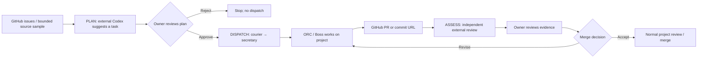

# ORC Canary — outside-agent prototype

A small **external** quality probe, not an ORC lane or ORC instruction. No changes to `CLAUDE.md`, `AGENTS.md`, secretary, boss, or other ORC startup files.

## What it does

1. `plan`: Search open GitHub issues first; if none exist, inspect a bounded selection of source and test files via the GitHub API, ask external `codex exec` for a justified small coding task, and save `runs/<id>/run.json`.
2. `dispatch`: After user review, send a **normal** task to ORC through `courier send secretary`.
3. `assess`: Once ORC returns a PR/commit URL, fetch GitHub's actual changes and have outside `codex exec` produce an independent, evidence-limited review.
4. `install-scheduler.ps1`: Optional Sunday scheduled **plan only**, disabled unless `-Install` is passed. No automatic merge, push, or release.

This is an operational smoke test, **not** a statistically reliable model benchmark. It cannot automatically prove regression from a single run. It does not observe full ORC execution traces or invoke hidden tests. It also does not currently automatically detect task completion; give the resulting PR/commit URL to `assess`.

## Workflow at a glance

This is a **conceptual flow**, not a captured terminal session or proof of a running scheduler.



### Example terminal walkthrough (illustrative)

```text
PS> python .\canary.py plan
      │
      └── Review runs/<id>/run.json before continuing.

PS> python .\canary.py dispatch <id>
      │
      └── Preview only — nothing is sent.

PS> python .\canary.py dispatch <id> --send
      │
      └── Explicitly send the approved task through Courier.

[ORC creates a PR or commit; obtain its real URL]

PS> python .\canary.py assess <id> --result-url <actual-github-url>
      │
      └── Review the external assessment and GitHub evidence.
```

**Safety boundary:** `plan` alone does not authorize `dispatch --send`. External assessments do not execute hidden tests or automatically merge code. The commands above are examples, not observed output.

## Prerequisites (LAB-PC)

- Windows PowerShell 7, Python >= 3.10, GitHub CLI `gh` logged in, external `codex` CLI signed in, `courier` CLI and running dispatcher on the LAB-PC.
- Local access to repositories per `gh` permission. No new Github permissions are needed by this program.
- Put this directory **outside ORC startup material**, e.g. `$DEV\tools\orc-canary`.
- Copy `config.example.json` to `config.json`, check the repository allowlist and target. Use harmless, small projects only. `gh issue list` only covers issues visible to your auth.

## Setup and commands

```powershell
Copy-Item .\config.example.json .\config.json
python .\canary.py plan
# inspect runs/<id>/run.json
python .\canary.py dispatch <id>                 # preview
python .\canary.py dispatch <id> --send          # explicit dispatch
# once ORC creates a PR/commit, independently evaluate its concrete result
python .\canary.py assess <id> --result-url https://github.com/NaNIsaac/hanfix/pull/123

# inspect weekly task; does not change anything
pwsh -File .\install-scheduler.ps1
# register planning-only task, after checking HH:mm and local timezone
pwsh -File .\install-scheduler.ps1 -Install -At 03:00
```

**Important:** Issue selection sends only repository, issue number, title, URL and labels to the external evaluator; issue bodies are neither requested nor forwarded. Titles and labels can still contain sensitive text, so restrict the allowlist to appropriate repositories. The code-sampling fallback sends bounded source snippets to the external evaluator; do not enable it for repositories with secrets or unpublished research data. Set the allowlist to repositories with readable source. If no eligible issues exist, the tool samples up to six small code/test files per repository. If no defensible task can be identified, it exits without dispatch. The external agent's output is schema-validated; only a URL returned by the GitHub API can be selected. PR/issue text is untrusted, and all subprocesses run without a shell. No code or files from issues are executed.

## Known limitations / next steps

- `codex exec -` semantics must be checked against the locally installed Codex CLI. This prototype expects the CLI to support a stdin prompt. If not, adjust `external_agent()` only.
- `courier doctor` reports failures unrelated to dispatch; if this makes dispatch too strict, replace with a targeted daemon health check, not a silent fallback to direct `herdr agent prompt`.
- `plan --send` allows unattended task dispatch **if explicitly selected**; do not put it in Task Scheduler until safe behavior and current task ownership are verified.
- Independent review is based on diff and GitHub status information; it does not execute the test suite. For a stronger evaluation use a separate disposable worktree and run tests with an explicit per-repository allowlist.
- External AI selection/review incurs API or subscription usage depending on your CLI account. Keep all work off ORC's prompt context.
- A real regression study needs stable benchmark tasks with repeated controlled runs, not only randomly selected GitHub issues.
